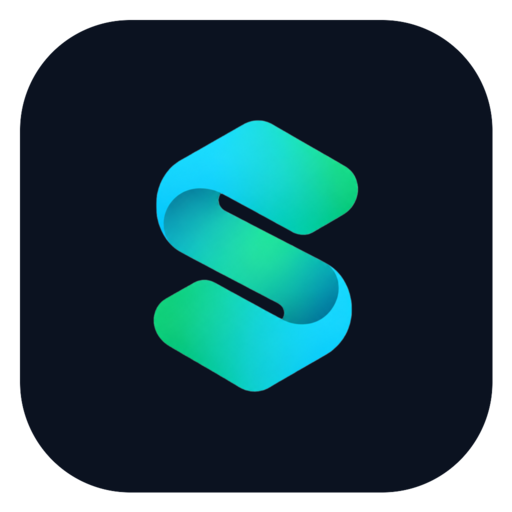

<div align="center">



# LectureSync

**A zero-bandwidth desktop orchestrator that moves large lecture files between Telegram, Google Drive and the web (OneDrive, YouTube, Dropbox, direct links…) via ephemeral cloud compute — with automatic extraction, smart compression and playlist archiving.**

[](https://github.com/92EPK/LectureSync/releases)
[](https://github.com/92EPK/LectureSync/actions/workflows/release.yml)

[](LICENSE)
[](https://cs-fgssr.pages.dev/)

🎓 *A free student initiative by **Ahmed Omran** — CS Diploma student at the Faculty of Graduate Studies for Statistical Research (FGSSR), Cairo University.*

[Website](https://92epk.github.io/LectureSync/) · [Features](#features) · [Download](#download) · [Quick start](#quick-start) · [Architecture](#architecture) · [Security](#security--privacy) · [System design](SYSTEM_DESIGN.md)

</div>

---

## Why

Course recordings are often shared as large, compressed and split archives inside Telegram groups. Getting them into Google Drive normally means downloading to a home PC, extracting, and uploading again — paying for every byte twice on metered, asymmetric consumer connections, and needing plenty of free disk space for the archive and its extracted copy.

LectureSync removes the user's machine from the data path. The desktop app is a **control plane** only; a disposable Google Colab VM owned by the user performs download, extraction and upload entirely inside datacenter networks.

| | Manual workflow | LectureSync |
|---|---|---|
| Data over the user's connection | the full file, downloaded and uploaded again | only small control messages |
| Local disk required | room for the archive and its extracted files | none |
| Archive handling | manual | automatic (zip, rar, 7z, tar, split volumes) |
| Telegram downloads | single stream | parallel streams |
| Directions | one way at a time, by hand | Telegram ⇄ Drive, plus web links → either |
| Lecture videos | uploaded at full size | optional compression, much smaller files |

## Features

### Three ways to move files

| Mode | What it does |
|---|---|
| 📥 **Telegram → Google Drive** | Pick files from any chat (or paste a `t.me/…` message link), choose a Drive folder, send. Archives are extracted automatically. |
| 📤 **Google Drive → Telegram** | Tick files or folders in Drive and send them to any chat, group or channel. Folders go as one ZIP or file by file; anything over Telegram's file-size limit is split into parts — only after you agree. |
| 🔗 **Link → Drive / Telegram** | Paste a public link and the Colab engine fetches it directly: **SharePoint / OneDrive, Google Drive shares, Dropbox, MediaFire, YouTube (videos & full playlists)** and direct file links. |

### Link import options

- **Quality picker** for video sites — 1080p, 720p (default, best for lectures), 480p or audio only.
- **Smart compression (optional)** — videos are re-encoded for lectures with FFmpeg (H.264, much smaller files, slides stay sharp); other files are packed with 7-Zip `-mx9`. Already-small files are left untouched.
- **Playlists, your way (optional)** — receive a YouTube playlist as **separate videos** (default, watchable right away) or as **one 7-Zip archive**: one `Course.7z` in Drive, or numbered `.7z.001`, `.7z.002`… parts in Telegram with unpack instructions in the caption. Free space is checked before each video and before packing; private or removed videos are skipped and reported.

### Core

- **Zero local bandwidth** — lecture bytes travel `Telegram ⇄ Colab ⇄ Drive` (and `Web → Colab`) only.
- **Job control** — live progress and speed for every transfer, with pause, resume, cancel and retry.
- **Type-aware pipeline** — archives are extracted; multi-file archives get their own folder; regular files (PDF, MP4, …) are copied as-is; failed extraction falls back to copying the original.
- **Parallel downloads** — large files are fetched in parallel chunks, with automatic sequential fallback.
- **QR-code Telegram login** — no SMS required (SMS is unreliable on many mobile networks and blocked for datacenter IPs). Phone code + 2FA remain available.
- **Drive file manager** — browse, search, create, rename and delete (to Drive trash) folders without leaving the app.
- **Stable notebook reuse** — one Colab notebook per user, reopened every session; no notebook sprawl.
- **Auto-retry on network drops** — transient failures retry automatically with growing back-off (configurable: off, 1, 2, 3 or 5 attempts); permanent errors (wrong password, missing file, no space) fail immediately.
- **System tray & background transfers** — closing or minimising the window keeps transfers running in the tray, with live status in the tray menu.
- **In-app update checker** — checks GitHub Releases on startup (or on demand) and downloads the right installer for your OS.
- **Sleep prevention** — keeps the computer awake while transfers run, then releases it.
- **Telegram select all** — pick every file in a chat with one click.
- **Professional settings** — tabbed Settings (Transfers, Alerts, Window, Telegram keys) with sounds, notifications and window behaviour your way.
- **Light / dark theme**, responsive layout, native notifications.
- **Bring-your-own credentials** — every user runs on their own Google account and Telegram API keys.

## Download

Get the latest build from **[Releases](https://github.com/92EPK/LectureSync/releases)**.

| Platform | File | First launch |
|---|---|---|
| Windows 10/11 (x64) — portable | `LectureSync-Portable-<version>-x64.exe` | SmartScreen → **More info → Run anyway** |
| Windows 10/11 (x64) — installer | `LectureSync Setup <version>.exe` | same as above |
| macOS 11+ Apple Silicon (M1–M4) | `LectureSync-<version>-arm64.dmg` | drag to Applications → right-click → **Open** |
| macOS 11+ Intel | `LectureSync-<version>-x64.dmg` | same as above |
| Linux x86-64 (any distro) | `LectureSync-<version>-x86_64.AppImage` | `chmod +x` then run |
| Debian / Ubuntu | `LectureSync_<version>_amd64.deb` | `sudo apt install ./LectureSync_*.deb` |

> **Why the OS warning?** Builds are not yet code-signed (Authenticode / Apple Developer ID). The warning is shown for every unsigned binary and is not a malware detection. Verify the download with the checksums below. If macOS reports the app as "damaged", run `xattr -cr /Applications/LectureSync.app` once.

### Verify your download

Each release ships `SHA256SUMS.txt`, generated in CI from the exact artifacts it publishes.

```bash
# macOS / Linux
shasum -a 256 -c SHA256SUMS.txt --ignore-missing
```

```powershell
# Windows (PowerShell)
Get-FileHash .\LectureSync-Portable-1.2.0-x64.exe -Algorithm SHA256
```

## Quick start

**Prerequisites:** a Google account, a Telegram account, and your own Telegram **API ID / API Hash** from [my.telegram.org](https://my.telegram.org) → *API development tools*.

Nothing else to install: Python, FFmpeg and 7-Zip run inside Colab, not on your computer.

1. **Enter your keys.** Launch LectureSync, open *my.telegram.org*, create an app, and paste the API ID and Hash. They are encrypted with the OS keychain.
2. **Start the engine.** Click **Start Colab engine**. The ready notebook [`LectureSync.ipynb`](https://colab.research.google.com/github/92EPK/LectureSync/blob/main/LectureSync.ipynb) opens in your normal browser, where you're already signed in to Google (Google blocks sign-in inside embedded app browsers, so the app never signs in itself).
3. **Run it.** Press **Run ▶** and allow Google Drive access. If Colab says *"This notebook was not authored by Google"*, choose **Run anyway** — the full code is visible in the notebook.
4. **Connect.** Click the green **Connect to LectureSync** button, choose **Open LectureSync**, and confirm in the app. No copy/paste, no local server and no open port.
5. **Sign in to Telegram** (first time only) by scanning the QR code from *Telegram → Settings → Devices → Link Desktop Device*. The session is saved in your own Google Drive, so later sessions reconnect without signing in again.
6. **Sync.** Choose a mode from the top bar:
   - **Telegram → Google Drive** — pick a Drive folder and Telegram files, press **Send to Drive**.
   - **Google Drive → Telegram** — tick Drive files/folders, choose a chat, press **Send to Telegram**.
   - **Link → Drive / Telegram** — paste a link, press **Check**, pick quality / compression / playlist format and destination, press **Start**.

> **Fallback:** if the Connect button doesn't open the app on your system, use *Connect with a link instead* in the app, or copy the worker cell into your own notebook — the app picks up the tunnel address automatically.

Keep the app and the Colab tab open while jobs run.

## Architecture

```text
 ┌──────────── Your computer ────────────┐          ┌────────── Your Google Colab VM ──────────┐
 │  LectureSync (Electron)               │  HTTPS   │  cloudflared ─► FastAPI + Telethon        │
 │  control plane · JSON only            │◄────────►│  data plane                               │
 └───────────────────────────────────────┘  token   │    Telegram ⇄ scratch ⇄ Drive             │
                                                    │    Web links (yt-dlp / HTTP) ─► scratch   │
                                                    │    scratch: 7-Zip · FFmpeg · split        │
                                                    └───────────────────────────────────────────┘
```

Full design, threat model and decision records: **[SYSTEM_DESIGN.md](SYSTEM_DESIGN.md)**.

## Build from source

Requires Node.js 18+.

```bash
git clone https://github.com/92EPK/LectureSync.git
cd LectureSync
npm install
npm start               # run in development
```

| Host OS | Command | Output in `release/` |
|---|---|---|
| Windows | `npm run build:win` | portable `.exe` + NSIS installer |
| Linux | `npm run build:linux` | `.AppImage` + `.deb` |
| macOS | `npm run build:mac` | `.dmg` + `.zip` (x64 + arm64) |

macOS images can only be produced on macOS; the CI pipeline handles all three.

### Releasing

```bash
# bump "version" in package.json first
git tag v1.2.0
git push origin v1.2.0
```

GitHub Actions builds on native Windows, Linux and macOS runners in parallel, computes SHA-256 checksums and publishes a Release . Builds can also be started manually from **Actions → Release → Run workflow**.

## Project structure

```text
LectureSync/
├── .github/workflows/release.yml   CI: 3-OS build matrix + GitHub Release
├── build/                          application icons (ico / png)
├── docs/                           project website (GitHub Pages)
├── LectureSync.ipynb               ready-made Colab notebook opened by the app
├── ui/                             renderer: HTML, CSS, vanilla JS
├── worker/server.py                Colab worker (FastAPI + Telethon), bundled into the app
├── main.cjs                        main process: secrets, worker client, Colab orchestration
├── preload.cjs                     contextBridge — the only renderer ↔ main interface
├── package.json                    dependencies and electron-builder targets
├── SYSTEM_DESIGN.md
└── LICENSE
```

## Security & privacy

- No telemetry, no analytics, no author-operated servers.
- API hash and access token encrypted at rest via Electron `safeStorage` (DPAPI · Keychain · libsecret).
- Every worker call is authenticated with a 192-bit random token; the tunnel URL alone grants nothing.
- Renderer runs with `contextIsolation`, no Node integration, and an allow-listed IPC surface.
- Drive operations are confined to `My Drive`; deletes go to Drive trash and require typing the exact name.

## Terms of service & responsible use

LectureSync is an educational utility. It uses only official interfaces — the Telegram client API (MTProto, user-issued keys) and Colab's built-in `google.colab.drive` mount — and runs on standard CPU runtimes for the duration of an interactive session. It does not mine, proxy, torrent or host public services. Users are responsible for moving only content they are entitled to access, and for complying with the terms of Google Colab and Telegram.

## Limitations

- Colab free-tier sessions have idle and maximum-length limits set by Google.
- Quick-tunnel URLs are ephemeral; the app rediscovers them automatically.
- Telegram's file-size limit applies (higher with Premium); bigger files are split into parts.
- Colab UI automation depends on Colab's page structure and may need updates when it changes.

## License

[MIT](LICENSE) © 2026 Ahmed Omran

**Author:** Ahmed Omran · [B9x@outlook.com](mailto:B9x@outlook.com) · GitHub [@92EPK](https://github.com/92EPK)
