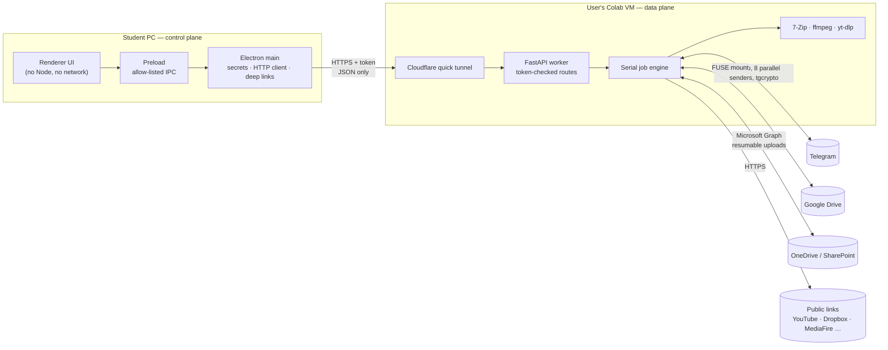
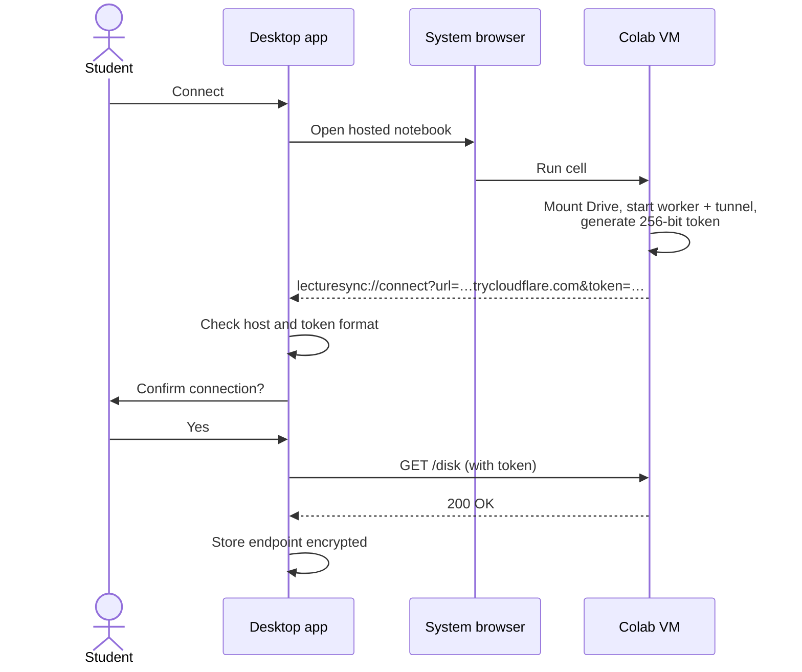
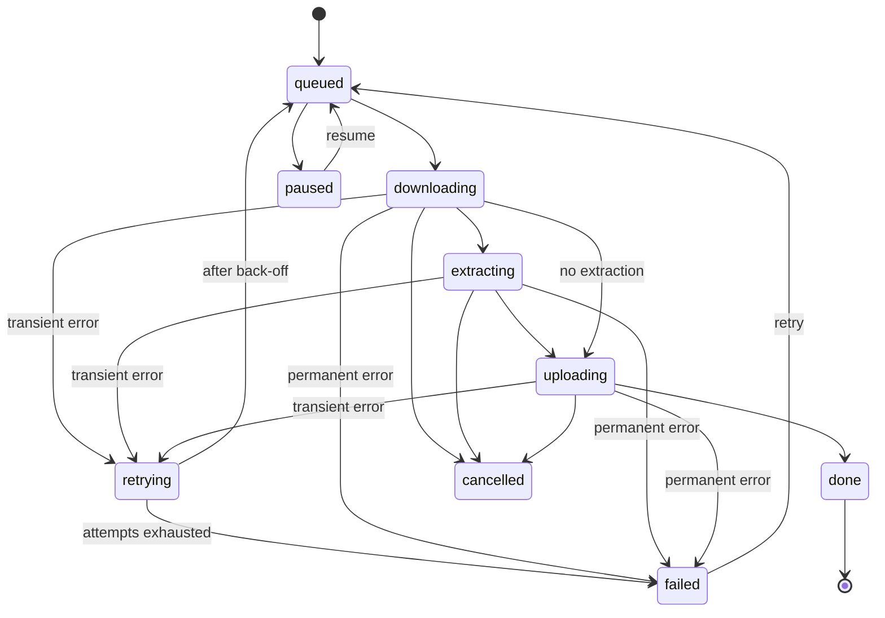

# LectureSync — System Design

> **Author:** Ahmed Omran · CS Diploma, FGSSR, Cairo University · [@92EPK](https://github.com/92EPK) · B9x@outlook.com
> **Scope:** design rationale, architecture and trade-offs behind LectureSync. For installation and usage see the [README](README.md).

---

## 1. Problem

My cohort receives lecture recordings (0.5–4 GB each) as zip/rar/7z archives, often split into volumes, inside Telegram groups. Everyone wants them organised in Google Drive. The obvious workflow is *download → extract → re-upload*, and in Egypt it breaks on three real constraints:

| Constraint | Consequence |
|---|---|
| **Metered, asymmetric home internet** | Each lecture costs about 2× its size in quota, and the slow upload leg dominates the time. |
| **Limited local disk** | Extracting needs about 2.2× the archive size free. |
| **Authentication friction** | Telegram SMS codes are often not delivered on local carriers; Google refuses sign-in inside embedded browsers. |

**Design question:** can a student move gigabytes between Telegram, Drive and the web *without spending their own bandwidth*, *without paying for a server*, and *without trusting a third party with their accounts*?

## 2. Key idea: split control from data

The user's PC should only **decide**; somewhere with datacenter bandwidth should **move the bytes**.

- **Control plane** — a small Electron desktop app. It sends JSON commands and shows progress. It never handles file content.
- **Data plane** — a FastAPI worker running on the user's **own free Google Colab VM**, which sits inside Google's network, next to Drive and close to Telegram's datacenters.

This produces three properties the rest of the design protects:

| Invariant | Meaning |
|---|---|
| **Zero bandwidth** | No content byte crosses the user's connection; control traffic is under 1 MB per session. |
| **Zero cost** | No server owned by me or the user; compute is free Colab, transport is a free Cloudflare quick tunnel. |
| **Zero custody** | I never receive anyone's credentials, sessions or files. Each user brings their own Telegram API keys and Google account. |

## 3. Architecture



| Part | Technology | Responsibility |
|---|---|---|
| Renderer (`ui/`) | HTML, CSS, vanilla JS | Interface only. Sandboxed: `contextIsolation`, no `nodeIntegration`. |
| Preload (`preload.cjs`) | `contextBridge` | The single, enumerated bridge between UI and main process. |
| Main (`main.cjs`) | Node / Electron 33 | Encrypted config (OS keystore), authenticated worker calls, Colab launch, deep-link validation. |
| Worker (`worker/server.py`) | FastAPI, Telethon, asyncio | Telegram I/O, job queue, extraction, link import, Drive file operations. |
| Notebook (`LectureSync.ipynb`) | Colab | Bootstraps the worker: mounts Drive, installs tools, starts uvicorn and the tunnel. |

## 4. Connecting the two planes

The VM is disposable and its URL changes every session, so the app needs a safe way to find it. I use a custom OS protocol (`lecturesync://`) instead of a local listening server, so the student's PC opens no port and triggers no firewall or antivirus prompt.



- Google sign-in happens in the **system browser**, because Google blocks embedded Chromium. This is the same approach VS Code and Slack use.
- Telegram login uses a **QR code** first (SMS is unreliable here), with phone code and 2FA as fallback. The session file is stored in the user's own Drive, so when Colab recycles the VM the next session reconnects without logging in again.
- If the protocol handler is unavailable, the app falls back to copying a self-contained bootstrap cell to the clipboard.

## 5. Transfer pipelines

| | Pipeline | Path |
|---|---|---|
| **P1** | Telegram → Drive | Parallel download → optional 7-Zip extraction → collision-safe move into Drive |
| **P2** | Drive → Telegram | Pre-flight checks → optional split/pack → parallel upload |
| **P3** | Link → Drive / Telegram | Resolve share link or yt-dlp → optional ffmpeg compression → deliver |

### Job lifecycle



Each job works in its own scratch directory, which is deleted on success, failure or cancellation.

## 5b. Dual-cloud model

Google Drive and OneDrive are interchangeable **storage providers** behind one interface (list, mkdir, rename, delete, quota, read, write). Every pipeline takes a provider argument, which gives four pipelines:

| Pipeline | Source → Destination |
|---|---|
| Telegram → Cloud | Telegram → Drive **or** OneDrive |
| Cloud → Telegram | Drive **or** OneDrive → Telegram |
| Link → Anywhere | Web → Drive / OneDrive / Telegram |
| Cloud ⇄ Cloud | Drive ⇄ OneDrive (`POST /copies`) |

**Drive** is reached through Colab's FUSE mount. **OneDrive** goes through Microsoft Graph: browser OAuth with PKCE or the Device Code flow (works for university tenants), a public client ID needing no admin consent, SharePoint libraries discovered via `/sites?search=*`, and upload sessions for large files. Tokens stay in the user's own Drive and Colab VM.

## 6. Engineering problems I solved

### 6.1 Telegram downloads were too slow

*Update:* two separate bottlenecks were found. **Crypto:** without a C backend, Telethon decrypts AES-IGE in pure Python (~0.4 MB/s measured). `cryptg` needs a Rust build that broke on Colab, so the worker patches Telethon to use **`tgcrypto`** (prebuilt wheels, ~137 MB/s measured, output byte-identical) and falls back silently if it is missing. **Transport:** `iter_download` segments share one MTProto socket, so the worker opens N independent `MTProtoSender`s to the file's DC, imports authorization once and reuses the key, and pulls `GetFileRequest` parts from a shared queue via `client._call`. Free accounts are still capped by Telegram at ~5–6 MB/s per account; Premium lifts it.

### 6.1a Original approach
Telethon downloads one file sequentially, and on Colab I measured about **1.3 MB/s**. Two causes:

1. **One stream.** I split each file into 512 KB-aligned ranges and fetch them with **8 concurrent `GetFileRequest` workers** that write by offset. Throughput went from ~1.3 MB/s to **tens of MB/s**.
2. **CPU-bound encryption.** MTProto encrypts every chunk with AES-IGE; in pure Python this saturates one core. The worker uses the native `tgcrypto` backend when available.

If any part fails, the job falls back to the sequential downloader, so the speed-up never costs correctness.

### 6.2 Uploads to Telegram
Uploads use 8 MTProto senders fed by **one sequential Drive reader**. Several random readers on a FUSE mount slowed it down, while a single reader keeps the mount efficient.

### 6.3 Files bigger than Telegram allows
Telegram caps files at 2 GB (4 GB with Premium). A pre-flight call returns size, limit and a split plan *before any byte is read*; oversized files are cut into 7z volumes only after the user agrees.

### 6.4 Never losing data
- **Admission control:** a job is rejected up front if scratch space is below size × 2.2.
- **Extraction fallback:** if extraction fails, the original archive is uploaded instead of being dropped.
- **No overwrites:** name collisions become `name (2).ext`.
- **Safe deletes:** Drive deletions go to trash and require typing the exact name.

### 6.5 Respecting rate limits
Jobs run one at a time and Telegram `FloodWait` responses are honoured. Simple serial scheduling made disk usage predictable and kept accounts away from bans.

### 6.6 Surviving network drops
Colab, Telegram and Drive connections drop occasionally on long transfers. The job engine classifies each failure:

- **Permanent** (wrong archive password, file not found, no space, file too big, private/forbidden) — the job fails at once; retrying cannot help.
- **Transient** (everything else) — the job enters `retrying n/max`, waits with growing back-off (3 s, 8 s, 15 s, 30 s, 60 s) and is re-queued.

The number of attempts (0–5) is a user setting synced from the app to the worker through `GET/POST /settings`.

### 6.7 Long transfers on the desktop
- **Sleep prevention:** while jobs are active the main process holds an Electron `powerSaveBlocker`, released as soon as the queue is idle.
- **System tray:** closing the window during active transfers hides it to the tray instead of quitting; minimising to tray is optional. The tray tooltip and menu show live status.
- **Update checker:** the main process queries the GitHub Releases API, compares semantic versions with `app.getVersion()` and offers the matching installer for the user's OS and architecture.

## 7. Security model

```text
 Renderer ──IPC──▶ Main ──HTTPS + token──▶ Worker ──official APIs──▶ Telegram / Google / link hosts
 untrusted         trusted                 trusted (user-owned VM)
```

| Threat | Mitigation |
|---|---|
| Someone finds the tunnel URL | Every route except `/health` requires a per-session high-entropy token. |
| A web page fires a forged `lecturesync://` link | Host must be `*.trycloudflare.com`, the token format is checked, the user confirms, and a live authenticated call verifies it. |
| XSS in the UI reaching the OS | Renderer isolated; only allow-listed IPC; all network I/O happens in the main process. |
| Path traversal on Drive | Every path is resolved and confined to `/content/drive/MyDrive`. |
| Secrets on disk | Encrypted with Electron `safeStorage` (DPAPI / Keychain / libsecret). Archive passwords stay in memory for one job. |
| Tampered binaries | Built in clean GitHub Actions runners from tagged source, with a published SHA-256 manifest. |

There is no telemetry or analytics. LectureSync registers no OAuth client of its own; the Drive consent screen belongs to Colab.

## 8. Design decisions and trade-offs

| Decision | Alternative considered | Why |
|---|---|---|
| Colab as compute | Rented VPS, or the home PC | Free, datacenter bandwidth, native Drive mount, nothing for me to operate. Cost: sessions are time-limited. |
| User brings their own Telegram keys | One shared app key | Isolates users and avoids a single point of ban; I hold no credentials. Cost: one extra setup step. |
| Deep link handshake | Local HTTP callback server | No open port on the student's PC. |
| Cloudflare quick tunnel | ngrok, port forwarding | No account, free TLS; the token supplies authentication. Cost: the URL changes each session. |
| Parallel range I/O with sequential fallback | Telethon default | Over 10× faster while staying correct on errors. |
| Serial job queue | Concurrent jobs | Predictable disk use and rate-limit safety, at the cost of total throughput. |
| Electron | Tauri, native apps | One JavaScript codebase and mature packaging for Windows, macOS and Linux. Cost: larger binary. |

## 9. Delivery

A GitHub Actions matrix (`.github/workflows/release.yml`) builds on native Windows, Ubuntu and macOS runners from a version tag and publishes:

- **Windows:** installer and portable `.exe`
- **macOS:** `.dmg` / `.zip` for Intel and Apple Silicon
- **Linux:** `.AppImage` and `.deb`

together with `SHA256SUMS.txt`. The project is used by my postgraduate diploma cohort.

## 10. Limitations and next steps

| Limitation | Planned direction |
|---|---|
| Colab free-tier sessions end unpredictably and the in-memory job list is lost | Persist range checkpoints and job history in the user's Drive to resume after a recycle. |
| Releases are unsigned, so SmartScreen and Gatekeeper warn on first run | Add Authenticode signing and Apple notarisation. |
| One job at a time | Concurrent jobs with adaptive rate control. |
| No automated tests | End-to-end tests against a mocked worker API. |
| Link-host page formats change | Per-platform resolvers are already isolated; yt-dlp updates each session. |

---

*A free student initiative at FGSSR, Cairo University — [cs-fgssr.pages.dev](https://cs-fgssr.pages.dev/). Licensed under [MIT](LICENSE).*
